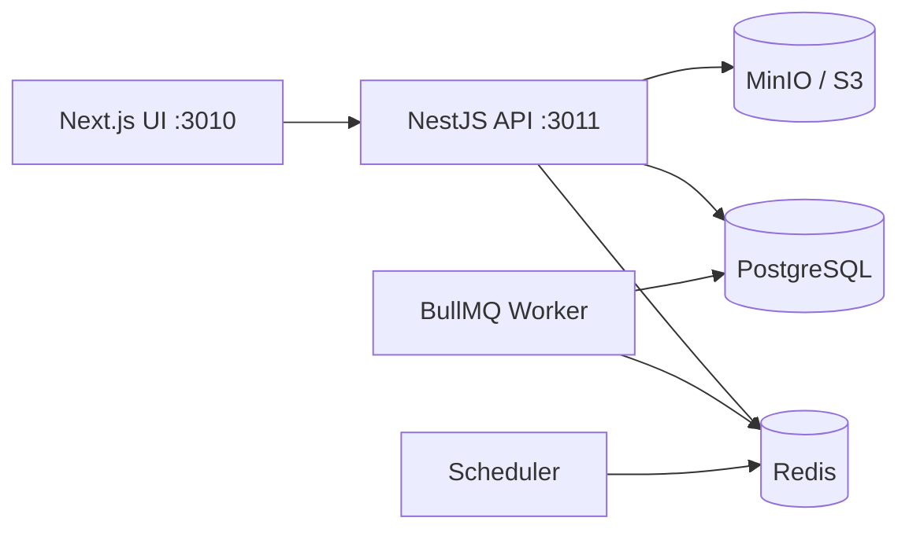

# Scrubber — Product Overview

## 1. Purpose

Scrubber (Neo Scrubber) is an **EDI 837P claims scrubber**. Organizations upload professional claim files, the platform parses and validates them against structural and business rules, and users review batch/claim results in a web UI.

## 2. Users

| Audience | Surface | Typical work |
|---|---|---|
| Tenant customers | `/portal` | Upload batches, review claims, team members, support, tenant audit |
| Platform staff | `/dashboard` | Cross-tenant batches, tenants/users, references, inquiries, audit |
| API clients | Machine tokens | Programmatic batch upload / integration |
| Super admins | Staff + settings | Permissions, audit categories, service clients |

See [Roles & Permissions](../security/roles-and-permissions).

## 3. System boundary

| In scope (implemented stack) | Out of scope for this site |
|---|---|
| NestJS API + Next.js UI under `C:\\sites\\Scrubber` | Speculating about unverified production infrastructure |
| EDI 837P parse, structural validation, claim validation | Claiming HIPAA certification without evidence |
| Tenants, auth, support, audit, references | Inventing endpoints or rules not in code |

## 4. Architecture (summary)

Details: [Architecture](../architecture/) · [Getting Started](../getting-started/local-development).

## 5. Source of truth

1. Executable code in `scrubber-backend` and `scrubber-frontend`
2. Prisma schema and Nest routes / OpenAPI export
3. App READMEs and feature notes under frontend `docs/`

This site expands verified behavior. Status labels (**Implemented** / **Partial** / **Planned** / **Unverified**) appear where assumptions would otherwise mislead.

## 6. How to navigate

- New engineers → [Local Development](../getting-started/local-development)
- Product flow → [Batches](../batches/) → [EDI 837P](../edi-837p/) → [Validation](../validation/)
- Contracts → [API](../api/) · [Data Model](../data-model/)
- Gaps → [Open Decisions](../decisions/open-decisions)

