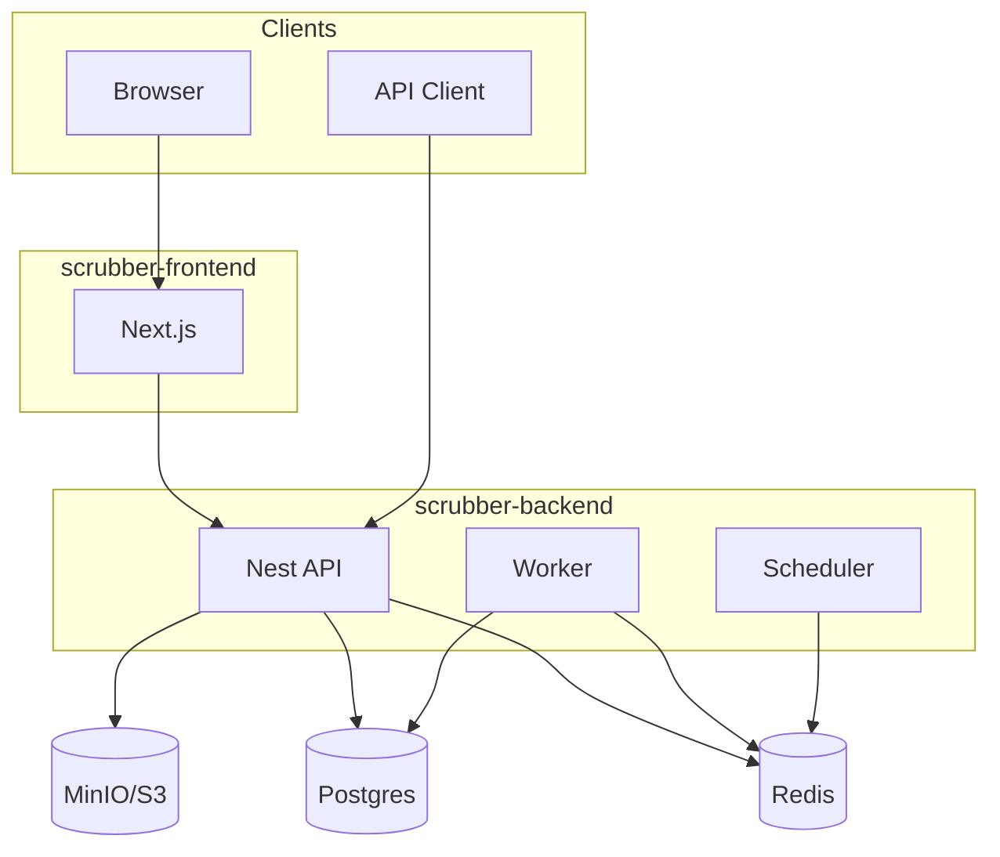

# Architecture

Sibling apps under `C:\\sites\\Scrubber`:

| App | Stack | Port |
|---|---|---|
| `scrubber-backend` | NestJS 10, Prisma, BullMQ | 3011 |
| `scrubber-frontend` | Next.js 16 App Router | 3010 |

- [Frontend](./frontend)
- [Backend](./backend)
- [Request Lifecycle](./request-lifecycle)
- [Data Flow](./data-flow)

